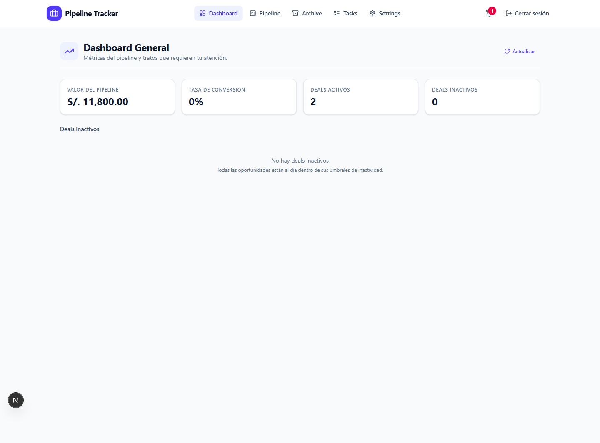
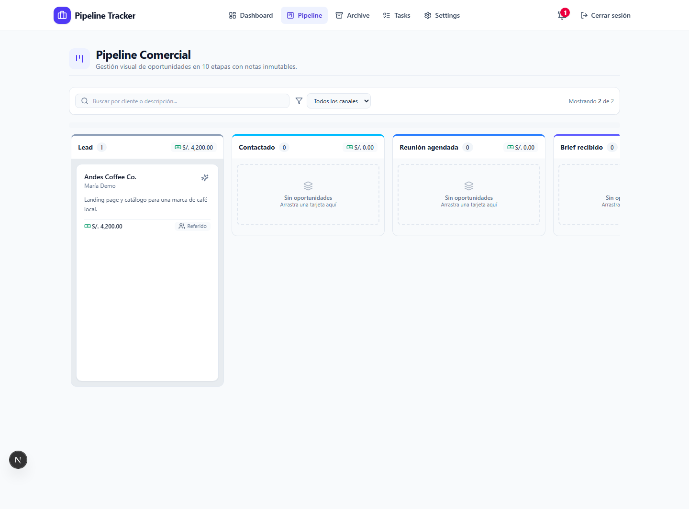
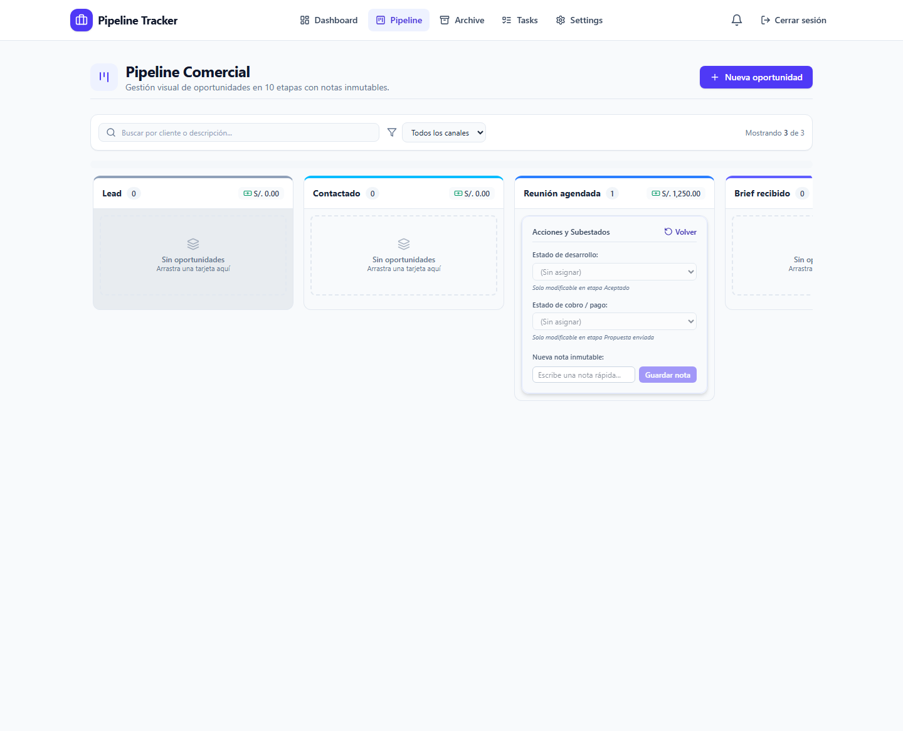
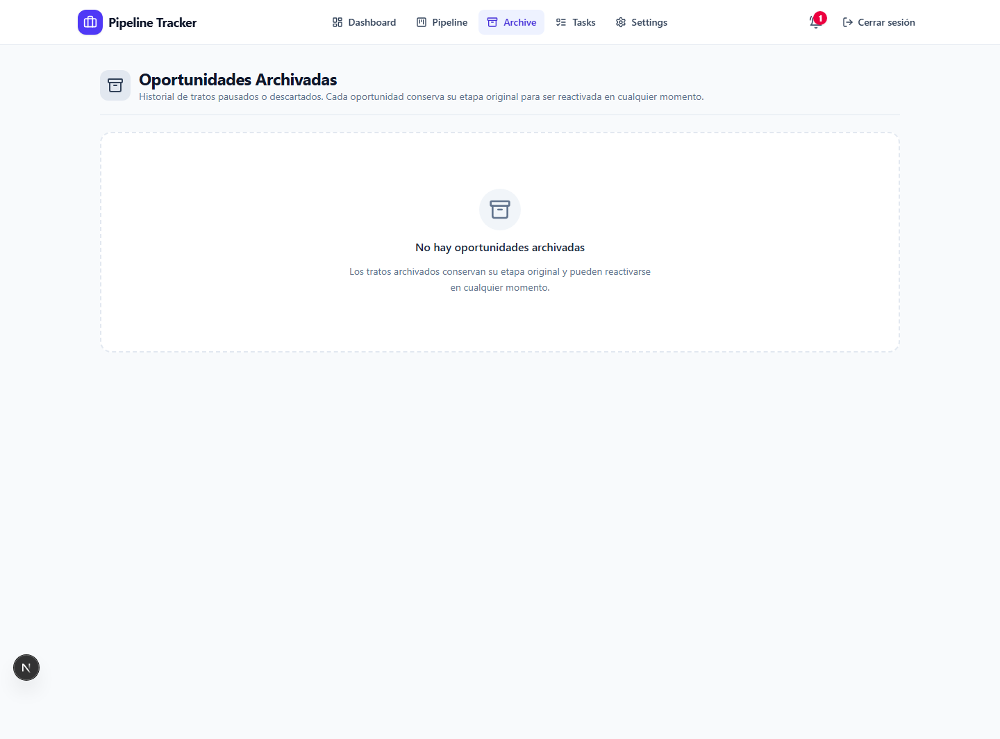
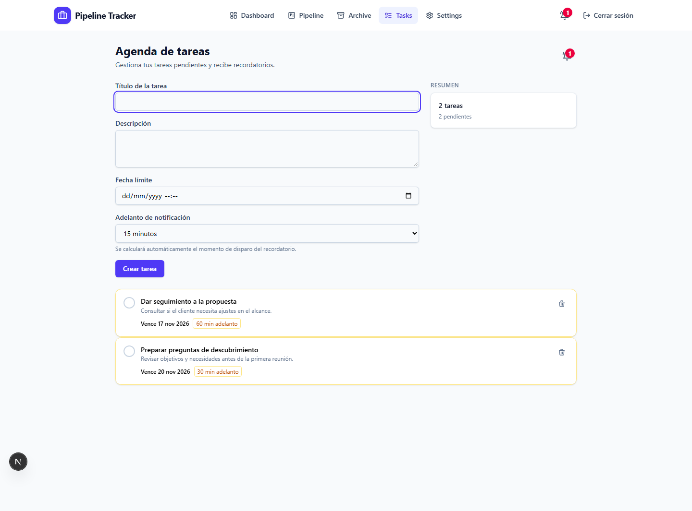
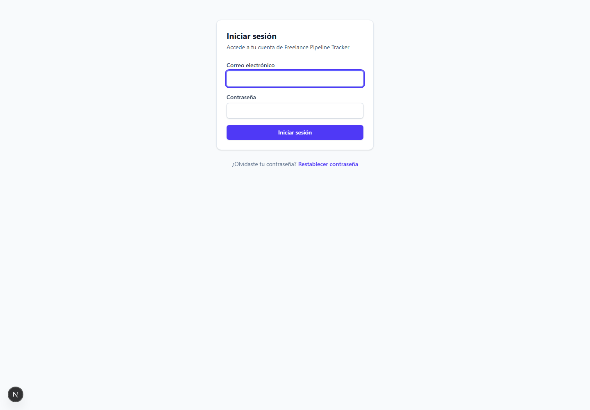

# Freelance Pipeline Tracker

[](https://github.com/linochamorro/freelance-pipeline-tracker/actions/workflows/ci.yml)
[](./LICENSE)
[](https://nodejs.org/)

Freelance Pipeline Tracker organiza oportunidades desde el primer contacto hasta la entrega y el cobro. Combina un tablero Kanban, una agenda de tareas, historial de cambios y métricas para profesionales independientes.

## Funciones

- Pipeline de diez etapas con búsqueda, filtros, transición de oportunidades y archivo/restauración.
- Historial de etapas, subestados y notas de solo adición.
- Indicadores de inactividad configurables y métricas de pipeline.
- Agenda independiente con avisos dentro de la aplicación y por correo.
- Autenticación propia con email y contraseña, recuperación mediante token de un solo uso y sesiones persistidas en PostgreSQL.
- Importes en soles peruanos, siempre con el símbolo literal `S/.`; sin conversión de divisas.

## Imágenes














## Stack y datos

Next.js 16 con App Router, React 19, TypeScript, Tailwind CSS 4 y PostgreSQL mediante Prisma 6. Zod valida entradas. El adaptador de correo puede usar Resend si se configura en el entorno local; las pruebas usan dobles y no envían correo.

El esquema Prisma define usuarios y sesiones, oportunidades, notas, historial de etapas y subestados, ajustes, tareas y notificaciones. Consulta `prisma/schema.prisma` para el contrato completo.

## Requisitos

- Node.js 22 o posterior.
- PostgreSQL local o de desarrollo para la aplicación y migraciones.
- `.env` local creado desde `.env.example`.

## Clonado y puesta en marcha

1. Clona el repositorio y entra en su carpeta:

   ```bash
   git clone https://github.com/linochamorro/freelance-pipeline-tracker.git
   cd freelance-pipeline-tracker
   ```

2. Instala dependencias:

   ```bash
   npm ci
   ```

   El hook `postinstall` genera el cliente Prisma. También puedes ejecutarlo manualmente:

   ```bash
   npx prisma generate
   ```

3. Copia `.env.example` como `.env` y configura `DATABASE_URL` para una base de desarrollo propia. `RESEND_API_KEY` y `EMAIL_FROM` son opcionales y solo se necesitan para probar el envío de correo en un entorno local autorizado. Nunca publiques `.env`.

4. Aplica las migraciones existentes:

   ```bash
   npx prisma migrate deploy
   ```

5. Opcionalmente, crea datos sintéticos para una demo local:

   ```bash
   node tools/scripts/seed-demo.mjs
   ```

   El script rechaza cualquier `DATABASE_URL` que no apunte a `localhost`, `127.0.0.1` o `::1`, no elimina datos y omite la siembra si ya existe la cuenta demo. En la primera ejecución muestra una contraseña aleatoria temporal; guárdala localmente y no la compartas.

6. Inicia Next.js:

   ```bash
   npm run dev
   ```

   Abre <http://localhost:3000>.

## Verificación

| Comando | Propósito |
|---|---|
| `npm run typecheck` | Verifica TypeScript sin emitir archivos. |
| `npm run lint` | Ejecuta ESLint con la configuración de Next.js. |
| `npm run test:unit` | Ejecuta unitarias aisladas de archivos `.env` y bases de datos remotas. |
| `npm test` | Ejecuta la suite unitaria y de integración. |
| `npm run build` | Genera la build de producción. |

La suite unitaria no requiere una base de datos remota ni credenciales. Las pruebas de integración usan la instancia aislada autorizada para QA.

## Arquitectura

- `src/app/`: páginas y Route Handlers.
- `src/components/`: componentes de interfaz.
- `src/lib/`: validación, sesión, adaptadores y reglas de dominio.
- `src/services/`: autenticación, oportunidades, tareas y métricas.
- `prisma/`: esquema y migraciones.
- `tests/unit/` y `tests/integration/`: pruebas permanentes.
- `docs/architecture/`, `docs/decisions/` y `docs/images/`: arquitectura, decisiones técnicas e imágenes del producto.

## Licencia

Este proyecto se distribuye bajo la licencia MIT. Consulta [`LICENSE`](./LICENSE).
