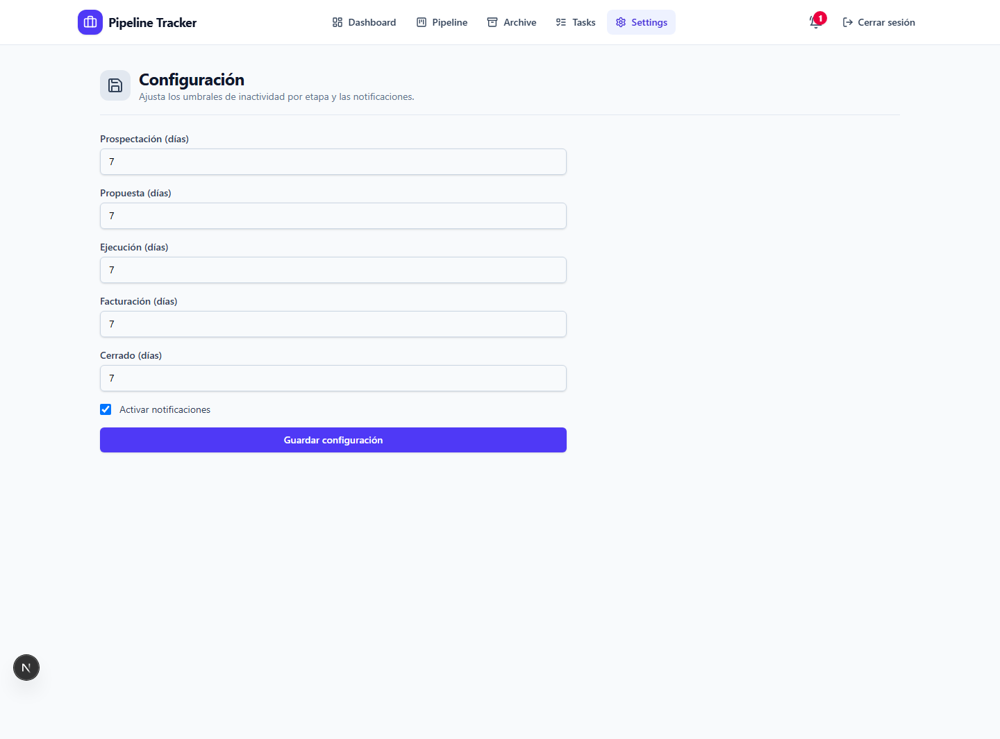

[](https://github.com/linochamorro/freelance-pipeline-tracker/actions/workflows/ci.yml)
[](https://nextjs.org)
[](https://react.dev)
[](https://www.typescriptlang.org)
[](https://www.postgresql.org)
[](https://www.prisma.io)
[](LICENSE)

# Freelance Pipeline Tracker — Gestión de oportunidades y seguimiento comercial

Aplicación web fullstack para organizar oportunidades comerciales desde el primer contacto hasta la entrega y el cobro. Combina un tablero Kanban de diez etapas con tarjetas reversibles, agenda independiente de tareas con alertas, notas inmutables, archivo de oportunidades y métricas de pipeline para profesionales independientes.

Freelance Pipeline Tracker es un proyecto de portfolio con datos de demostración. La documentación describe el código y la configuración del repositorio; no acredita un despliegue activo ni la disponibilidad de servicios externos.

## Funcionalidades

- **Pipeline Kanban de 10 etapas:** Alta de oportunidades, búsqueda, filtros por etapa/canal, transiciones validadas, reordenamiento accesible (`@dnd-kit`) y archivo/restitución.
- **Subestados e historial inmutable:** Seguimiento de estados de pago y desarrollo activados según la etapa actual, historial de cambios y notas de solo adición (*append-only*).
- **Indicadores de inactividad (*staleness*):** Umbrales configurables por etapa y métricas consolidadas en el panel principal.
- **Agenda de tareas y notificaciones:** Tareas con cinco opciones de anticipación (`15m`, `30m`, `60m`, `120m`, `1d`), campana de avisos in-app y adaptador de correo configurable (Resend en producción, dobles en pruebas).
- **Autenticación y sesiones:** Registro, inicio de sesión con cookies `httpOnly`, recuperación de contraseña no enumeradora con token de un solo uso y sesiones persistidas en PostgreSQL.
- **Moneda unificada:** Importes expresados en soles peruanos (`S/.`) sin conversión de divisas.

La vista general del sistema está documentada en [docs/architecture/00-overview.md](docs/architecture/00-overview.md).

## Tecnología y estructura

Next.js 16 (App Router), React 19, TypeScript, Tailwind CSS 4, PostgreSQL, Prisma 6, Zod, `@dnd-kit` y Vitest.

| Ruta | Contenido |
|---|---|
| `src/app/` | Páginas de aplicación (auth y dashboard) y Route Handlers de la API |
| `src/components/` | Componentes de interfaz (`auth`, `dashboard`, `kanban`, `layout`, `tasks`) |
| `src/lib/` | Reglas puras de dominio, validaciones Zod, sesión, formateo y adaptador de correo |
| `src/services/` | Lógica de negocio (autenticación, oportunidades, notas, archivo, tareas y métricas) |
| `src/types/` | Contratos y tipos compartidos |
| `prisma/` | Esquema (`schema.prisma`) y migraciones de PostgreSQL |
| `tests/unit/` | Pruebas unitarias aisladas (reglas, servicios, validaciones y UI) |
| `tests/components/` | Pruebas de componentes de layout y tareas |
| `tests/integration/` | Pruebas de integración contra PostgreSQL |
| `tests/e2e/` | Recorrido completo de extremo a extremo sobre servidor local |
| `tools/scripts/` | Utilidades locales (siembra de datos de demostración) |
| `docs/architecture/`, `docs/decisions/` | Documentación técnica y registros de decisiones (ADR) |
| `docs/images/` | Capturas de interfaz del producto |

## Inicio local

Requisitos: Node.js 22 o posterior, dependencias npm y una instancia local o de desarrollo de PostgreSQL.

```bash
git clone https://github.com/linochamorro/freelance-pipeline-tracker.git
cd freelance-pipeline-tracker
npm ci
cp .env.example .env
# Configura DATABASE_URL en .env apuntando a tu base PostgreSQL local.
npx prisma migrate deploy
npm run dev
```

Para poblar una cuenta y oportunidades de demostración en tu entorno local (`localhost` / `127.0.0.1`), puedes ejecutar:

```bash
node tools/scripts/seed-demo.mjs
```

El script rechaza cualquier `DATABASE_URL` que apunte fuera de loopback, no elimina datos existentes y muestra en consola la contraseña aleatoria generada en la primera ejecución. No ejecutes migraciones ni utilidades de siembra contra bases de datos compartidas o de producción.

## Comandos del proyecto

| Comando | Uso |
|---|---|
| `npm run dev` | Servidor de desarrollo en `http://localhost:3000` |
| `npm run typecheck` | Comprobación estática de TypeScript (`tsc --noEmit`) |
| `npm run lint` | Análisis estático con ESLint |
| `npm run test:unit` | Pruebas unitarias aisladas (`vitest.unit.config.ts`, sin `.env` ni BD) |
| `npm test` | Suite completa (unitarias, componentes, integración y E2E) |
| `npm run build` | Compilación de producción (`next build`) |

El workflow de CI en `.github/workflows/ci.yml` ejecuta instalación (`npm ci`), `typecheck`, `lint`, `test:unit` (37 archivos, 334 pruebas aisladas sin dependencia de base de datos) y `build`.

Las pruebas de integración y E2E operan sobre estado persistente en PostgreSQL y no deben dirigirse a datos reales.

## Imágenes

### Tablero Kanban y seguimiento


### Gestión de tareas y archivo


<details>
<summary>Otras vistas</summary>




</details>

## Documentación

- [Arquitectura del sistema](docs/architecture/00-overview.md)
- [Índice de decisiones técnicas (ADR)](docs/decisions/index.md)

## Licencia

Licencia MIT; consulta [LICENSE](LICENSE).
